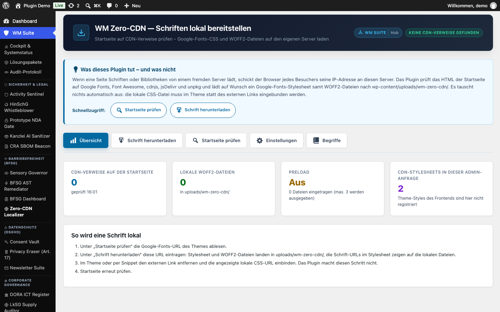
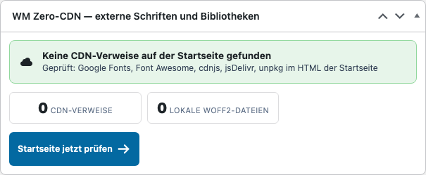

# WM Zero-CDN Asset Localizer (Deutsche Dokumentation)

<p align="center">
  <a href="README.md"></a>
  <a href="README.de.md"></a>
  <a href="README.es.md"></a>
</p>

> **Prüft die Startseite auf Verweise zu Google Fonts, Font Awesome, cdnjs, jsDelivr und unpkg und lädt ein Google-Fonts-Stylesheet samt WOFF2-Dateien in den Upload-Ordner der eigenen Website — den externen Link im Theme zu ersetzen bleibt ein manueller Schritt**  
> **Plugin-Seite:** [https://arnoldwender.com/wordpress-plugins/wm-zero-cdn-asset-localizer/](https://arnoldwender.com/wordpress-plugins/wm-zero-cdn-asset-localizer/)  
> **Mit einem agentischen Workflow entwickelt:** entstanden mit KI-Coding-Agenten. Prüfen und testen Sie es wie jeden fremden Code, bevor Sie es produktiv einsetzen.  
> **Support & Haftung:** Kein Support (Zero Support) — reproduzierbare Bugs ausschließlich über [GitHub Issues](https://github.com/arnoldwender/wm-wp-zero-cdn-asset-localizer/issues) · kein privater Support · OHNE GEWÄHR („AS IS“) / keine Haftung ([SUPPORT.md](SUPPORT.md))

> Diese Datei beschreibt ausschließlich, was das Plugin tatsächlich ausliefert (`v1.2.1`): Startseiten-Prüfung auf fünf CDN-Anbieter, manuellen Download von Google-Fonts-Stylesheets samt WOFF2-Dateien nach `uploads/wm-zero-cdn/`, optionale Preload-Links, eine Fünf-Reiter-Oberfläche inklusive Einstellungen, die REST-Routen `/scan` und `/localize`, die WP-CLI-Befehle `wp cdn scan` und `wp cdn localize`, WordPress 6.5+ Block Bindings (`wm-zero-cdn/status`), das GenerateBlocks-2.x-Dynamic-Tag (`{{wm_zero_cdn_status}}`) sowie den Spoke-Adapter für den WM Suite Hub. Auf der Website wird nichts automatisch abgefangen oder ersetzt; Shortcodes, eigene Datenbanktabellen oder Prüfexporte sind nicht enthalten.

---

## Screenshots

!WM Zero-CDN Asset Localizer Banner

| Screenshot | Beschreibung |
| --- | --- |
|  | Übersicht: CDN-Verweise auf der Startseite (Seite gelesen, in dieser Aufnahme keine gefunden), lokale WOFF2-Dateien, Preload-Status, CDN-Stylesheets der Admin-Anfrage und die manuellen Schritte |
|  | Dashboard-Widget zu lokalisierten Schriftarten und erkannten externen Ressourcen |

---

## Was das Plugin leistet

1. **Prüfung der Startseite:** `CdnDetector::scan_front_page()` ruft die eigene Startseite ab (`wp_safe_remote_get( home_url( '/' ) )`, Status 200 erforderlich) und findet in ihrem HTML jeden Verweis auf `fonts.googleapis.com`, `fonts.gstatic.com` (dort liegen die Schriftdateien selbst), `use.` / `kit.` / `ka-f.fontawesome.com`, `cdnjs.cloudflare.com`, `cdn.jsdelivr.net` und `unpkg.com` — mit oder ohne Schema (`//fonts.googleapis.com/…`), in `<link>`, `<script>`, einem `@font-face` im Seiten-CSS, einem `preconnect` oder einer JSON-escapten Zeichenkette in einem Skript. Gemeldet wird die URL, die ein Browser anfragt: JSON-Escapes und HTML-Entities werden aufgelöst, und ein `url(…)` ohne Anführungszeichen endet an der Klammer. Das Ergebnis sagt, ob die Seite gelesen wurde; eine nicht lesbare Seite wird als nicht lesbar gemeldet, nie als sauber, und nur eine Minute statt zehn zwischengespeichert. Lädt ein Browser eine solche URL, schickt er die IP-Adresse des Besuchers an diesen Host — mehr stellt die Prüfung nicht fest.
2. **Stylesheet-Download:** `AssetDownloader::localize_css()` weist zuerst alles ab, was keine `http`/`https`-URL ist, und jeden Host, der eine private, Loopback- oder reservierte IP-Adresse ist. Dann lädt es das Stylesheet (Status 200, CSS-Inhaltstyp, höchstens 2 MB), prüft jede `url(…woff2)` gegen `AssetDownloader::is_allowed_font_host()` (erlaubt denselben Host sowie `DEFAULT_ALLOWED_FONT_HOSTS`, filterbar über `wm_zero_cdn_allowed_font_hosts`), lädt zulässige URLs — in Anführungszeichen oder ohne, absolut, ohne Schema oder relativ zum Stylesheet, mit oder ohne Query, höchstens 50 je Stylesheet und einmal je URL —, speichert nur Inhalte, die mit der WOFF2-Signatur `wOF2` beginnen **und tatsächlich geschrieben wurden**, schreibt diese URLs auf die lokalen Kopien um, legt das Stylesheet unter `wp-content/uploads/wm-zero-cdn/local_<hash>.css` ab (neben einer `index.php` gegen Verzeichnislisten) und löst `wm_zero_cdn_stylesheet_localized` aus. Alle Downloader-Anfragen laufen über `wp_safe_remote_get()` mit einem per `http_api_curl` auf die geprüfte IP gepinnten `CURLOPT_RESOLVE`. **Das lokale Stylesheet wird nicht eingebunden**: Theme oder Snippet müssen es statt des externen Links laden.
3. **Preload-Links:** Auf `wp_head` (Priorität 1) wird die Liste aus `wm_zero_cdn_preload_fonts` zuerst gefiltert — Dateiname auf `.woff2` und Datei in `uploads/wm-zero-cdn/` vorhanden — und erst dann werden die ersten drei als `<link rel="preload" as="font">` ausgegeben, sofern `wm_zero_cdn_preload_enabled` gesetzt ist. Beide Optionen lassen sich unter *Einstellungen* oder per gleichnamigem Filter setzen.
4. **Backend:** Menü *Zero-CDN* (Position 85), Seite `wm-zero-cdn` mit fünf Tabs: Übersicht mit gemessenen Werten und den manuellen Schritten; Download-Formular mit vier Google-Fonts-Beispielen; Prüfung der Startseite (immer frisch); Einstellungen (Preload sowie die Opt-in-Option `wm_zero_cdn_delete_data_on_uninstall` für das Löschen bei Deinstallation); kurzes Glossar. Ein Dashboard-Widget zeigt die zwischengespeicherte Prüfung und die Zahl lokaler Schriften. Oberfläche auf den Admin-Stylesheets der WM-Suite-Familie mit 28 kompilierten `.po`/`.mo`-Sprachkatalogen.
5. **REST** (`manage_options`): `GET /wp-json/wm-zero-cdn/v1/scan`, `POST /wp-json/wm-zero-cdn/v1/localize` mit `url` als Pflicht-Zeichenkette im URI-Format; ein fehlgeschlagener Download antwortet mit 502. **WP-CLI**: `wp cdn scan` (bricht mit Fehler ab, wenn die Startseite nicht lesbar ist) und `wp cdn localize <url>`.
6. **Block Bindings & GenerateBlocks:** `BlockIntegrations` registriert die WordPress-6.5+-Block-Bindings-Quelle `wm-zero-cdn/status` (`summary`, `cdn_refs`, `local_fonts`, `state`) und das GenerateBlocks-2.x-Dynamic-Tag `{{wm_zero_cdn_status}}` auf Basis des zwischengespeicherten Prüfergebnisses ohne Loopback-Anfragen beim Seitenaufruf.
7. **WM Suite Hub Spoke:** `includes/Adapters/Zero_Cdn_Spoke_Adapter.php` meldet sich über `wm_register_suite_module`: Health `HEALTHY` nur bei gelesener Startseite ohne Verweise, sonst `DEGRADED`; Telemetrie, CycloneDX-SBOM sowie die Aktionen `self_test` und `scan`.

### Nicht enthalten

Kein automatisches Abfangen, Deregistrieren oder Umschreiben von Theme- oder Plugin-Assets; keine Konvertierung anderer Schriftformate; kein Download von Nicht-WOFF2-Schriften, JavaScript-Bibliotheken oder Font-Awesome-Kits; keine Prüfung von Unterseiten, Stylesheet-Inhalten oder zur Laufzeit nachgeladenen Skripten; kein Shortcode, keine eigene Datenbanktabelle, kein Prüfexport; keine Anfrage an andere Hosts als die Startseite und die von Administratoren eingetragenen URLs.

---

## Schnellstart

1. Plugin installieren und aktivieren (WordPress 6.4+, PHP 8.2+).
2. **Zero-CDN › Startseite prüfen** öffnen und die gefundenen Verweise ablesen.
3. Eine Google-Fonts-Stylesheet-URL unter **Schrift herunterladen** eintragen (oder `wp cdn localize "<url>"`). Die zurückgegebene lokale CSS-URL notieren.
4. Im Theme (oder per Snippet) den externen Google-Fonts-Link entfernen und die lokale CSS-URL einbinden. Startseite erneut prüfen.

Klassen, Routen, Befehle, Hooks, Optionen und bekannte Abweichungen: **[README.md](README.md)** (Referenz) und **[DEVELOPERS.md](DEVELOPERS.md)**.

```bash
php tests/test-suite.php         # Prüfung, Startseite, Download, Preload, REST, Hooks/Bindings, Admin-Skript, Deinstallation
php tests/test-uninstall.php     # Standard-Datenerhalt sowie Opt-in-Löschung von Optionen, Transient, Dateien und Ordner
php tests/test-pot-freshness.php # languages/*.pot stimmt mit den übersetzbaren Zeichenketten überein
bash tests/run-mutations.sh      # jede Korrektur aus tests/mutations.php muss eine Suite rot machen
# in einem echten WordPress, nur lesend:
wp eval-file wp-content/plugins/wm-zero-cdn-asset-localizer/tests/wp-runtime-zero-cdn.php --user=1
```

---

## Konformität

- **Was das Plugin feststellt:** ob das HTML der Startseite fünf CDN-Hosts nennt, und auf Wunsch eine lokale Kopie eines Google-Fonts-Stylesheets. Es trifft keine rechtliche Bewertung und macht eine Website nicht von sich aus urteils- oder gesetzeskonform; die Website lädt externe Schriften, bis das Theme geändert wird.
- **Ausgehende Anfragen:** die eigene Startseite (Loopback), die von Administratoren eingetragene Stylesheet-URL und die Schrift-URLs, die dieses Stylesheet nennt — beschränkt auf denselben Host oder die filterbare CDN-Host-Allowlist (`AssetDownloader::DEFAULT_ALLOWED_FONT_HOSTS`). Private, Loopback- und reservierte Adressen sowie Nicht-HTTP-Schemata werden abgewiesen, ebenso nicht auflösbare Namen; der Downloader pinnt zudem die geprüfte IP per `CURLOPT_RESOLVE` über `http_api_curl` vor dem Verbindungsaufbau von `wp_safe_remote_get()`.
- **Datenschutz & Aufbewahrung:** es werden keine personenbezogenen Daten gespeichert; das Plugin speichert drei Konfigurationsoptionen (`wm_zero_cdn_preload_enabled`, `wm_zero_cdn_preload_fonts`, `wm_zero_cdn_delete_data_on_uninstall`), einen Transient mit dem Prüfergebnis und Dateien in `uploads/wm-zero-cdn/`. Bei der Deinstallation bleiben Daten standardmäßig erhalten und werden nur bei aktiviertem Opt-in für die aktuelle Website entfernt.

---

## Lizenz

Vertrieben unter der **GNU General Public License v2 oder neuer** (`GPL-2.0-or-later`).  
Copyright (C) 2026 Arnold Wender. Alle Rechte vorbehalten.  
