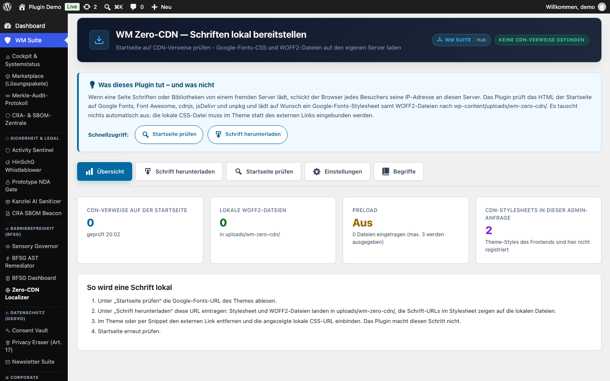
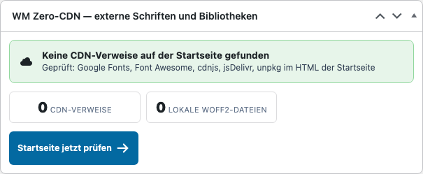

# WM Zero-CDN Asset Localizer (Documentación en Español)

<p align="center">
  <a href="README.md"></a>
  <a href="README.de.md"></a>
  <a href="README.es.md"></a>
</p>

> **Revisa la portada del sitio en busca de referencias a Google Fonts, Font Awesome, cdnjs, jsDelivr y unpkg y descarga una hoja de Google Fonts con sus archivos WOFF2 a la carpeta de subidas del propio sitio — sustituir el enlace externo en el tema sigue siendo un paso manual**  
> **Página del Plugin:** [https://arnoldwender.com/es/plugins-wordpress/wm-zero-cdn-asset-localizer/](https://arnoldwender.com/es/plugins-wordpress/wm-zero-cdn-asset-localizer/)  
> **Desarrollado con un agentic workflow:** creado con agentes de programación de IA. Revísalo y pruébalo como cualquier código de terceros antes de usarlo en producción.  
> **Soporte y responsabilidad:** Cero soporte (Zero Support) — errores reproducibles únicamente en [GitHub Issues](https://github.com/arnoldwender/wm-wp-zero-cdn-asset-localizer/issues) · sin soporte privado · TAL CUAL («AS IS») / sin responsabilidad ([SUPPORT.md](SUPPORT.md))

> Este archivo describe únicamente lo que el plugin entrega (`v1.2.0`): revisión del HTML de la portada para cinco proveedores CDN, descarga manual de hojas de Google Fonts con archivos WOFF2 a `uploads/wm-zero-cdn/`, enlaces opcionales de precarga, pantalla de administración de cinco pestañas con ajustes, rutas REST `/scan` y `/localize`, comandos WP-CLI `wp cdn scan` y `wp cdn localize`, fuente de Block Bindings de WordPress 6.5+ (`wm-zero-cdn/status`), etiqueta dinámica de GenerateBlocks 2.x (`{{wm_zero_cdn_status}}`) y adaptador spoke para WM Suite Hub. Nada se intercepta ni se sustituye automáticamente en el sitio, ni existen shortcodes, tablas propias ni exportaciones de auditoría.

---

## Capturas de pantalla

!Banner de WM Zero-CDN Asset Localizer

| Captura | Descripción |
| --- | --- |
|  | Resumen: referencias CDN en la portada (ilegible en esta captura, con el error de loopback), archivos WOFF2 locales, estado de la precarga, hojas CDN de la petición del admin y los pasos manuales |
|  | Widget del escritorio con estado de recursos localizados y detecciones CDN |

---

## Qué hace el plugin

1. **Revisión de la portada:** `CdnDetector::scan_front_page()` pide la portada del propio sitio (`wp_safe_remote_get( home_url( '/' ) )`, estado 200 obligatorio) y encuentra en su HTML cada referencia a `fonts.googleapis.com`, `fonts.gstatic.com` (donde están los archivos de fuente), `use.` / `kit.` / `ka-f.fontawesome.com`, `cdnjs.cloudflare.com`, `cdn.jsdelivr.net` y `unpkg.com` — con o sin esquema (`//fonts.googleapis.com/…`), en `<link>`, `<script>`, un `@font-face` en línea, un `preconnect` o una cadena JSON escapada dentro de un script. Se reporta la URL que pide el navegador: se resuelven los escapes JSON y las entidades HTML, y un `url(…)` sin comillas termina en el paréntesis. El resultado indica si la página se leyó; una página ilegible se reporta como ilegible, nunca como limpia, y se guarda un minuto en vez de diez.
2. **Descarga de hojas de estilo:** `AssetDownloader::localize_css()` rechaza primero lo que no sea una URL `http`/`https` y todo host que sea una dirección IP privada, de loopback o reservada. Luego descarga la hoja (estado 200, tipo de contenido CSS, máximo 2 MB), valida cada `url(…woff2)` con `AssetDownloader::is_allowed_font_host()` (permite el mismo host o `DEFAULT_ALLOWED_FONT_HOSTS`, filtrable mediante `wm_zero_cdn_allowed_font_hosts`), descarga las URL permitidas — entre comillas o sin ellas, absoluta, sin esquema o relativa a la hoja, con o sin query, máximo 50 por hoja y una vez por URL —, guarda solo contenidos que empiezan con la firma WOFF2 `wOF2` **y que se escribieron de verdad**, reescribe esas URL a las copias locales, deja la hoja en `wp-content/uploads/wm-zero-cdn/local_<hash>.css` junto a un `index.php` y lanza `wm_zero_cdn_stylesheet_localized`. Todas las peticiones del descargador van por `wp_safe_remote_get()` con `CURLOPT_RESOLVE` fijado a la IP validada mediante un hook de un solo uso en `http_api_curl`. **La hoja local no se encola**: el tema o un snippet deben cargarla en lugar del enlace externo.
3. **Enlaces de precarga:** en `wp_head` (prioridad 1) la lista de `wm_zero_cdn_preload_fonts` se filtra primero — nombre terminado en `.woff2` y archivo presente en `uploads/wm-zero-cdn/` — y solo entonces se imprimen los tres primeros como `<link rel="preload" as="font">`, si `wm_zero_cdn_preload_enabled` está activa. Ambas opciones pueden configurarse en la pestaña *Einstellungen* o mediante filtros del mismo nombre.
4. **Administración:** menú *Zero-CDN* (posición 85), página `wm-zero-cdn` con cinco pestañas: resumen con cifras medidas y pasos manuales; formulario de descarga con cuatro ejemplos de Google Fonts; revisión de la portada (siempre nueva); ajustes (precarga y opción expresa `wm_zero_cdn_delete_data_on_uninstall` para borrar datos al desinstalar); glosario breve. Un widget del escritorio muestra la revisión guardada y el número de fuentes locales. Interfaz sobre las hojas admin de la familia WM Suite con 28 catálogos `.po`/`.mo` compilados.
5. **REST** (`manage_options`): `GET /wp-json/wm-zero-cdn/v1/scan`, `POST /wp-json/wm-zero-cdn/v1/localize` con `url` declarada como cadena obligatoria en formato URI; una descarga fallida responde 502. **WP-CLI**: `wp cdn scan` y `wp cdn localize <url>`.
6. **Block Bindings y GenerateBlocks:** `BlockIntegrations` registra la fuente de Block Bindings de WordPress 6.5+ `wm-zero-cdn/status` (`summary`, `cdn_refs`, `local_fonts`, `state`) y la etiqueta dinámica de GenerateBlocks 2.x `{{wm_zero_cdn_status}}` leyendo la caché de revisión sin peticiones loopback en portada.
7. **Spoke del WM Suite Hub:** `includes/Adapters/Zero_Cdn_Spoke_Adapter.php` se registra por `wm_register_suite_module`: salud `HEALTHY` solo con la portada leída y sin referencias, `DEGRADED` en otro caso; telemetría, SBOM CycloneDX y acciones `self_test` y `scan`.

### No incluido

Sin interceptación, desregistro ni reescritura automática de recursos del tema o de plugins; sin conversión de otros formatos de fuente; sin descarga de fuentes que no sean WOFF2, bibliotecas JavaScript ni kits de Font Awesome; sin revisión de subpáginas, del contenido de las hojas ni de scripts cargados en tiempo de ejecución; sin shortcode, tabla propia ni exportación de auditoría; sin peticiones a otros hosts que la portada y las URL que introduzca un administrador.

---

## Inicio rápido

1. Instala y activa el plugin (WordPress 6.4+, PHP 8.2+).
2. Abre **Zero-CDN › Startseite prüfen** y lee las referencias de la portada.
3. Copia una URL de hoja de Google Fonts en **Schrift herunterladen** (o ejecuta `wp cdn localize "<url>"`). Anota la URL local que devuelve.
4. En el tema (o con un snippet), quita el enlace externo de Google Fonts y encola la URL local. Vuelve a revisar la portada.

Clases, rutas, comandos, hooks, opciones y desviaciones conocidas: **[README.md](README.md)** (referencia) y **[DEVELOPERS.md](DEVELOPERS.md)**.

```bash
php tests/test-suite.php         # revisión, portada, descarga, precarga, REST, hooks/bindings, script del admin, desinstalador
php tests/test-uninstall.php     # conservación por defecto y borrado opcional de opciones, transient, archivos y carpeta
php tests/test-pot-freshness.php # languages/*.pot coincide con las cadenas traducibles del código
bash tests/run-mutations.sh      # cada corrección de tests/mutations.php debe poner una suite en rojo
# dentro de un WordPress real, solo lectura:
wp eval-file wp-content/plugins/wm-zero-cdn-asset-localizer/tests/wp-runtime-zero-cdn.php --user=1
```

---

## Conformidad

- **Lo que establece el plugin:** si el HTML de la portada nombra cinco hosts CDN y, si se pide, una copia local de una hoja de Google Fonts. No hace ninguna evaluación legal ni vuelve un sitio conforme a ninguna sentencia o norma por sí solo; el sitio sigue cargando fuentes externas hasta que se cambie el tema.
- **Peticiones salientes:** la portada del propio sitio (loopback), la URL de hoja que introduzca un administrador y las URL de fuente que esa hoja nombre — restringidas al mismo host o a la lista blanca filtrable de hosts CDN (`AssetDownloader::DEFAULT_ALLOWED_FONT_HOSTS`). Se rechazan direcciones privadas, de loopback y reservadas, nombres no resolubles y esquemas que no son HTTP, y se fija `CURLOPT_RESOLVE` a la IP validada antes de que `wp_safe_remote_get()` conecte.
- **Privacidad y retención:** no se guardan datos personales; el plugin conserva tres opciones de configuración (`wm_zero_cdn_preload_enabled`, `wm_zero_cdn_preload_fonts`, `wm_zero_cdn_delete_data_on_uninstall`), un transient con el resultado de la revisión y archivos en `uploads/wm-zero-cdn/`. Al desinstalar se conservan los datos por defecto y solo se eliminan en el sitio actual si se activa expresamente `wm_zero_cdn_delete_data_on_uninstall`.

---

## Licencia

Distribuido bajo la **GNU General Public License v2 o posterior** (`GPL-2.0-or-later`).  
Copyright (C) 2026 Arnold Wender. Todos los derechos reservados.  
