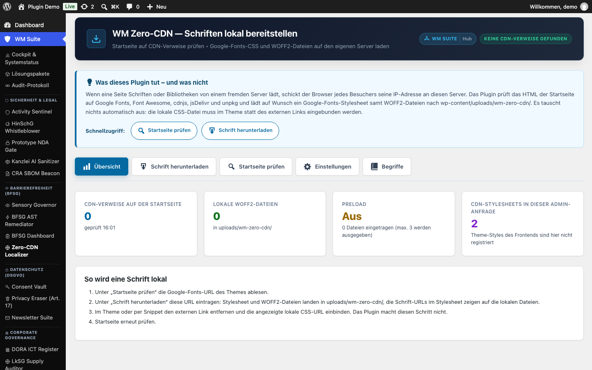
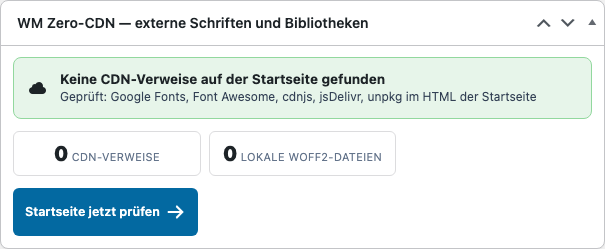

# WM Zero-CDN Asset Localizer

<p align="center">
  <a href="README.md"></a>
  <a href="README.de.md"></a>
  <a href="README.es.md"></a>
  <a href="#translated-documentation"></a>
</p>

<p align="center">
  <a href="https://wordpress.org"></a>
  <a href="https://php.net"></a>
  <a href="https://www.gnu.org/licenses/gpl-2.0.html"></a>
</p>

> **Checks the site's front page for Google Fonts, Font Awesome, cdnjs, jsDelivr and unpkg references and downloads a Google Fonts stylesheet with its WOFF2 files into the site's own uploads folder — replacing the remote link in the theme stays a manual step**  
> **Plugin Page:** [https://arnoldwender.com/wordpress-plugins/wm-zero-cdn-asset-localizer/](https://arnoldwender.com/wordpress-plugins/wm-zero-cdn-asset-localizer/)  
> **Built with an agentic workflow:** developed with AI coding agents. Review and test it like any third-party code before you use it in production.  
> **Support & Liability:** Zero support — reproducible bugs on [GitHub Issues](https://github.com/arnoldwender/wm-wp-zero-cdn-asset-localizer/issues) only · no private support · AS IS / no liability ([SUPPORT.md](SUPPORT.md))

> This README describes only what the plugin ships (`v1.2.1`): a front-page HTML scan for five CDN providers, manual WOFF2 stylesheet localization into `uploads/wm-zero-cdn/`, optional `<link rel="preload">` tags, a five-tab admin screen with settings, REST routes `/scan` and `/localize`, WP-CLI commands `wp cdn scan` and `wp cdn localize`, WordPress 6.5+ Block Bindings (`wm-zero-cdn/status`), GenerateBlocks 2.x Dynamic Tag (`{{wm_zero_cdn_status}}`), and the WM Suite Hub spoke adapter. Nothing on the site is intercepted, dequeued or replaced automatically, and no shortcode, custom database table or audit log export is included.

---

## Screenshots

!WM Zero-CDN Asset Localizer banner

| Screenshot | Description |
| --- | --- |
|  | Overview tab: front-page CDN references (page read, none found in this capture), local WOFF2 files, preload state, CDN stylesheets of the admin request and the manual steps |
|  | Dashboard widget reporting localized font assets and external CDN detections |

---

## What the plugin does

1. **Front-page scan.** `CdnDetector::scan_front_page()` fetches the site's own front page (`wp_safe_remote_get( home_url( '/' ) )`, status 200 required) and finds every reference in its HTML to `fonts.googleapis.com`, `fonts.gstatic.com` (where the font files themselves live), `use.` / `kit.` / `ka-f.fontawesome.com`, `cdnjs.cloudflare.com`, `cdn.jsdelivr.net` and `unpkg.com` — with or without a scheme (`//fonts.googleapis.com/…`), inside `<link>`, `<script>`, an inline `@font-face`, a `preconnect` or a JSON-escaped string in a script. The reported URL is the one a browser requests: JSON escapes and HTML entities are resolved, and an unquoted `url(…)` stops at the parenthesis. The result says whether the page was read; an unreadable page is reported as unreadable, never as clean, and is cached for one minute instead of ten. When a browser loads such a URL, it sends the visitor's IP address to that host — that is all the scan establishes.
2. **Stylesheet download.** `AssetDownloader::localize_css( $url )` refuses anything that is not an `http`/`https` URL, and any host that is a private, loopback or reserved IP address, before it makes a request. It then fetches the stylesheet (status 200 and a CSS content type required, at most 2 MB), checks every `url(…woff2)` against `AssetDownloader::is_allowed_font_host()` (allowing the stylesheet's own host and `DEFAULT_ALLOWED_FONT_HOSTS`, filterable via `wm_zero_cdn_allowed_font_hosts`), fetches allowed URLs — quoted, bare, absolute, protocol-relative, relative to the stylesheet, with or without a query, at most 50 per stylesheet and once per distinct URL — stores only bodies that start with the WOFF2 signature `wOF2` **and only when the file was actually written**, rewrites those URLs to the local copies and writes the stylesheet to `wp-content/uploads/wm-zero-cdn/local_<hash>.css`, beside an `index.php` so the folder does not enumerate. It returns the local CSS URL, the fonts stored (each once) and the fonts that failed (those keep their remote URL, including untrusted external font hosts), and fires `wm_zero_cdn_stylesheet_localized` on success. Every downloader request goes through `wp_safe_remote_get()` with `CURLOPT_RESOLVE` pinned via a one-shot `http_api_curl` hook to the validated IP. **The local stylesheet is not enqueued**: the theme or a snippet has to load it instead of the remote link.
3. **Preload links.** On `wp_head` (priority 1), when the option `wm_zero_cdn_preload_enabled` is truthy and `wm_zero_cdn_preload_fonts` lists file names, the list is filtered first — a name must end in `.woff2` and the file must exist in `uploads/wm-zero-cdn/` — and the first three survivors are printed as `<link rel="preload" as="font" type="font/woff2" crossorigin="anonymous">`. Both values can be configured on the *Einstellungen* tab or passed through filters of the same name.
4. **Admin.** Menu *Zero-CDN* (position 85), page `wm-zero-cdn` with five tabs: an overview with measured figures (CDN references on the front page, local WOFF2 files, preload state, CDN stylesheets registered in the admin request) and the manual steps; a download form with four Google Fonts examples; the front-page scan (always fresh) with the list of references; a settings screen (`wm_zero_cdn_preload_enabled`, `wm_zero_cdn_preload_fonts`, and opt-in `wm_zero_cdn_delete_data_on_uninstall`); and a short glossary. A dashboard widget shows the cached scan and the local font count. German source interface with 28 compiled `.po`/`.mo` locale catalogs on the WM Suite admin family sheets.
5. **REST** (`manage_options`): `GET /wp-json/wm-zero-cdn/v1/scan` (front-page scan plus registered styles), `POST /wp-json/wm-zero-cdn/v1/localize` with `url` declared as a required string in URI format, so an array or a missing value is refused with 400 before the callback runs; a download that failed answers 502. **WP-CLI**: `wp cdn scan` (exits with an error when the front page cannot be read) and `wp cdn localize <url>` — WP-CLI runs with no user, so these commands are available to whoever can run `wp` on the server.
6. **Block Bindings & GenerateBlocks.** `BlockIntegrations` registers the WordPress 6.5+ Block Bindings source `wm-zero-cdn/status` (`key`: `summary`, `cdn_refs`, `local_fonts`, `state`) and the GenerateBlocks 2.x Dynamic Tag `{{wm_zero_cdn_status}}` (`field`: `summary`, `cdn_refs`, `local_fonts`, `state`), reading the cached scan transient and local WOFF2 count without triggering loopback HTTP requests during page rendering.
7. **WM Suite Hub spoke.** `includes/Adapters/Zero_Cdn_Spoke_Adapter.php` registers through `wm_register_suite_module`: health `HEALTHY` only when the front page was read and holds no reference, `DEGRADED` otherwise; telemetry with the scan state, reference count (`null` when unreadable), preload settings and local font count; CycloneDX SBOM metadata; actions `self_test` and `scan`.

### Not shipped

No automatic interception, dequeueing or rewriting of theme or plugin assets; no conversion of other font formats to WOFF2; no download of non-WOFF2 fonts, JavaScript libraries or Font Awesome kits; no scan of subpages, of stylesheets' contents or of scripts injected at runtime; no shortcode, custom database table or audit export; no request to any host except the front page and the URLs an administrator enters.

---

## Quick start

1. Install and activate the plugin (WordPress 6.4+, PHP 8.2+).
2. Open **Zero-CDN › Startseite prüfen** and read the references the front page carries.
3. Copy a Google Fonts stylesheet URL into **Schrift herunterladen** (or run `wp cdn localize "<url>"`). Note the local CSS URL it returns.
4. In the theme (or a snippet), remove the remote Google Fonts link and enqueue the local CSS URL. Check the front page again.

---

## Developers

Classes, routes, commands, hooks, options and the hub adapter: **[DEVELOPERS.md](DEVELOPERS.md)**.

```bash
php tests/test-suite.php        # scan coverage and normalisation, front-page scan, downloader refusals, url() forms, counting, preload, REST, hooks/bindings, admin and uninstaller — HTTP stubbed per URL
php tests/test-uninstall.php    # default preservation + opt-in removal of options, transient, files and directory
php tests/test-pot-freshness.php # languages/*.pot matches every translatable string in code
bash tests/run-mutations.sh     # every correction in tests/mutations.php must turn a suite red when undone
# inside a real WordPress, read-only, safe on a live site:
wp eval-file wp-content/plugins/wm-zero-cdn-asset-localizer/tests/wp-runtime-zero-cdn.php --user=1
```

### Known issues

- The front-page scan needs a loopback request to the site's own URL. Hosts that block loopback, sites behind HTTP authentication and containers whose public port differs from the internal one report the page as unreadable.
- Only the listed hosts and only references present in the front page HTML are found; stylesheets' contents, scripts that build URLs at runtime and subpages are not checked.
- `url()` references in the downloaded stylesheet that are not `.woff2` stay remote. The stylesheet and the fonts are served publicly from uploads as downloaded.
- Files are written with `file_put_contents()` rather than the WordPress filesystem API; every write is checked, and a write that fails is reported as a failure.
- Uninstalling preserves options and `uploads/wm-zero-cdn/` by default unless `wm_zero_cdn_delete_data_on_uninstall` is enabled under **Zero-CDN › Einstellungen**. When enabled, uninstalling cleans the **current** site; on a network install the other sites' copies stay.

---

## Translated documentation

Translated READMEs live in `docs/translations/README.<lang>.md`; their headings are translated and their bodies are generated from this file, which is the reference — a translated table of contents over an English document.

For the WordPress admin and block editor interface itself, `languages/` ships 28 compiled `.po`/`.mo` catalogs covering all 90 strings (including plural forms) across 28 locales.

| Language (Native) | Locale Code | Language (Native) | Locale Code |
|---|---|---|---|
| [Български](docs/translations/README.bg.md) | `bg_BG` | [Magyar](docs/translations/README.hu.md) | `hu_HU` |
| [Čeština](docs/translations/README.cs.md) | `cs_CZ` | [Italiano](docs/translations/README.it.md) | `it_IT` |
| [Dansk](docs/translations/README.da.md) | `da_DK` | [Lietuvių](docs/translations/README.lt.md) | `lt_LT` |
| [Deutsch](README.de.md) | `de_DE` | [Latviešu](docs/translations/README.lv.md) | `lv_LV` |
| [Ελληνικά](docs/translations/README.el.md) | `el_GR` | [Malti](docs/translations/README.mt.md) | `mt_MT` |
| [English](README.md) | `en_GB` | [Nederlands](docs/translations/README.nl.md) | `nl_NL` |
| [Español](README.es.md) | `es_ES` | [Polski](docs/translations/README.pl.md) | `pl_PL` |
| [Eesti](docs/translations/README.et.md) | `et_EE` | [Português](docs/translations/README.pt.md) | `pt_PT` |
| [Suomi](docs/translations/README.fi.md) | `fi_FI` | [Română](docs/translations/README.ro.md) | `ro_RO` |
| [Français](docs/translations/README.fr.md) | `fr_FR` | [Slovenčina](docs/translations/README.sk.md) | `sk_SK` |
| [Gaeilge](docs/translations/README.ga.md) | `ga_IE` | [Slovenščina](docs/translations/README.sl.md) | `sl_SI` |
| [Hrvatski](docs/translations/README.hr.md) | `hr_HR` | [Svenska](docs/translations/README.sv.md) | `sv_SE` |

---

## Compliance

- **What the plugin establishes:** whether the front page HTML references five CDN hosts, and a local copy of a Google Fonts stylesheet when asked. It makes no legal assessment and does not make a site compliant with any judgment or regulation by itself; a site keeps loading remote fonts until the theme is changed.
- **Outbound requests:** the site's own front page (loopback), the stylesheet URL an administrator enters, and the font URLs that stylesheet names — restricted to the stylesheet's own host or the filterable CDN font host allowlist (`AssetDownloader::DEFAULT_ALLOWED_FONT_HOSTS`). Non-HTTP schemes are refused, and so is a host that is — or resolves to — a private, loopback or reserved address; a name that cannot be resolved is refused as well. Every downloader request re-validates the resolved public IP and pins `CURLOPT_RESOLVE` via a one-shot `http_api_curl` hook before `wp_safe_remote_get()` connects, closing the DNS-rebinding window between validation and cURL socket connect.
- **Privacy & data retention:** no personal data is stored; the plugin stores only its three configuration options (`wm_zero_cdn_preload_enabled`, `wm_zero_cdn_preload_fonts`, `wm_zero_cdn_delete_data_on_uninstall`), one transient with the scan result, and downloaded font/CSS files in `uploads/wm-zero-cdn/`. Uninstalling preserves options and files by default and removes them for the active site only when `wm_zero_cdn_delete_data_on_uninstall` is enabled.

---

## Contribution & Security

- [CONTRIBUTING.md](CONTRIBUTING.md) · [SECURITY.md](SECURITY.md) · [CHANGELOG.md](CHANGELOG.md)

---

## License

Distributed under the **GNU General Public License v2 or later** (`GPL-2.0-or-later`).  
Copyright (C) 2026 Arnold Wender.  
